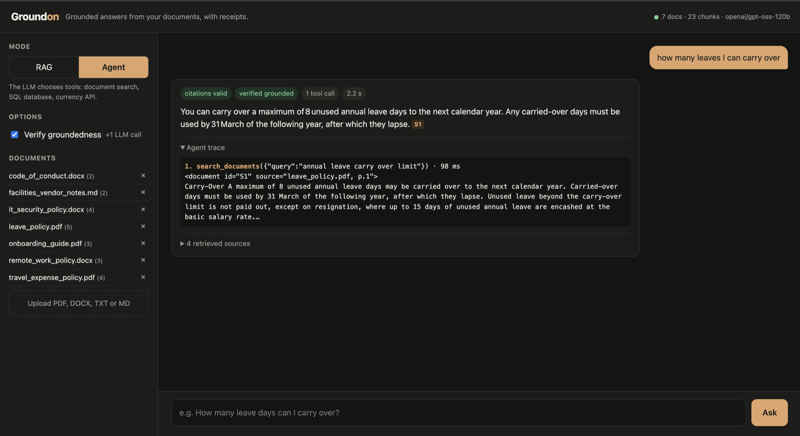
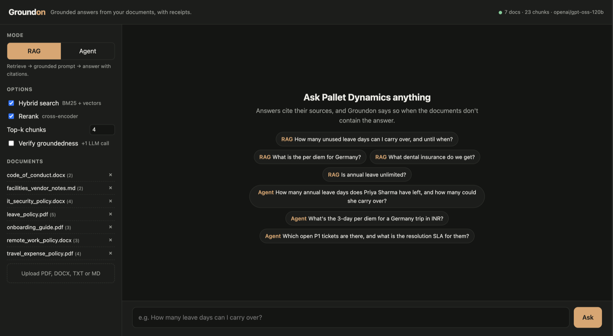

# Groundon

**Hallucination-resistant agentic RAG over enterprise documents.**
Upload PDFs/DOCX, ask questions, and get answers that cite their sources, or an honest
*"I couldn't find this"* when the documents don't have the answer. In agent mode, the LLM
decides whether to search documents, query an SQL database, or call a live currency API.

Python · FastAPI · FAISS · sentence-transformers · BM25 · cross-encoder reranking · Groq (gpt-oss-120b) tool calling · Docker



## At a glance

Measured on a 38-question eval set (details in [Evaluation](#evaluation)). The "not found" threshold was
tuned on this same set, so treat the answer numbers as an upper bound rather than held-out performance:

- **100% answer accuracy, 0% false abstention.** Every answerable question answered correctly, none refused.
- **100% correct "not found"** on the 5 unanswerable questions. 3 of them are rejected before any LLM call.
- **Reranking lifts answer-chunk hit@1 from 85% to 94%.**
- **The groundedness verifier caught 63 of 63 corrupted answers** (wrong numbers, invented claims), with
  one false alarm in 33 correct answers.
- **Prompt injection resisted.** A poisoned document in the corpus doesn't change the answer.

**Where to look in the code:**

| To see… | Read |
|---|---|
| The abstain gate and grounded generation | `groundon/generation/rag.py` |
| Citation checks and the LLM-as-judge verifier | `groundon/generation/grounding.py` |
| Hybrid search, RRF and reranking | `groundon/retrieval/retriever.py` |
| The agent's tool loop and read-only SQL | `groundon/agent/` |
| Prompt-injection defences | `groundon/guard.py` |
| How results are measured | `eval/run_eval.py`, `eval/verifier_eval.py` |

The reasoning behind each choice, plus a 5-minute walkthrough and the known limitations, is in
[docs/design-decisions.md](docs/design-decisions.md).

---

## Architecture

```
 INGESTION                                              QUERY (RAG mode)
 ─────────                                              ────────────────
 PDF / DOCX / MD / TXT                                  question
        │ parsers.py (keeps page numbers)                  │
        ▼                                                  ├──► embed (same model) ──► FAISS top-20 ─┐
 sentence-aware chunks, 500 chars, 100 overlap             └──► BM25 top-20 ────────────────────────┤
        │ chunker.py                                                                               ▼
        ▼                                                     Reciprocal Rank Fusion (hybrid search)
 local embeddings (all-MiniLM-L6-v2, 384-d, normalised)                                            │
        │                                                     cross-encoder rerank ─► top-k chunks │
        ▼                                                                                          ▼
 ┌──────────────────────┐    ┌──────────────────────┐   confidence < threshold? ──yes──► "not found" (no LLM call)
 │ FAISS IndexFlatIP    │◄──►│ SQLite: chunk text,  │                │ no
 │ id → vector          │ id │ source, page, doc_id │                ▼
 └──────────────────────┘    └──────────────────────┘   injection scan + <document> isolation
                                                                     ▼
                                                        grounded prompt ─► Groq LLM ─► answer [S1][S2]
                                                                     ▼
                                                        citation check (code) + optional verifier (LLM-as-judge)
```

**Agent mode** (`/agent`): the LLM receives three tool schemas and loops: call tool → read result → decide.

```
question ─► LLM ──► search_documents(query)            → same hybrid+rerank retriever, citable [S#]
             ▲  ├─► query_database(sql)                → read-only SQLite (4 layers of protection)
             │  └─► convert_currency(amount, from, to) → live rates (frankfurter.dev)
             └──── tool results ◄──┘     … until it answers (max 6 steps) → citation check / verifier
```

## How hallucinations are reduced

| Root cause | Defence | Where |
|---|---|---|
| Right context never retrieved | Hybrid BM25 + vector search, cross-encoder reranking, overlapping chunks | `retrieval/` |
| Weak context, LLM guesses anyway | **Abstain gate**: low retrieval confidence → "not found" *without calling the LLM* | `generation/rag.py` |
| | Grounding prompt: answer only from context, cite every claim, exact abstain phrase, temperature 0 | `generation/prompts.py` |
| LLM goes beyond the context | **Citation check**: every `[S#]` must match a retrieved chunk; uncited answers flagged | `generation/grounding.py` |
| | **Verifier** (opt-in `verify=true`): a cheaper model judges each claim against sources | `generation/grounding.py` |
| Malicious documents | Injection detection, `<document>` isolation with tag escaping, "documents are data" rule | `guard.py` |
| Agent invents numbers | Facts must come from tools; SQL is read-only; tool errors are fed back so the agent can self-correct | `agent/` |

## Quickstart

```bash
python3 -m venv .venv && source .venv/bin/activate
pip install -r requirements-dev.txt
cp .env.example .env               # add your GROQ_API_KEY (free: https://console.groq.com/keys)

python scripts/generate_sample_docs.py   # demo corpus for the fictional "Pallet Dynamics"
uvicorn groundon.main:app --reload       # auto-ingests data/docs on first start
```

**Multiple API keys:** set `GROQ_API_KEY_1`, `GROQ_API_KEY_2`, … (or a comma-separated `GROQ_API_KEYS`).
Requests rotate round-robin across keys. A rate-limited (429) or failing key fails over to the next
one immediately, and the client backs off only when every key has failed in a row (`generation/llm.py`).
Groq enforces limits **per organization**, so keys from the same account share one quota. Measured with
two such keys: their rate-limit headers counted down together. Rotation then gives failover, not extra capacity.

**Protecting the corpus:** set `ADMIN_API_KEY` to require an `X-API-Key` header for uploading and deleting
documents (anyone who can upload can plant a poisoned document). Reads and questions stay open; the web UI
asks for the key when needed. Without it the server logs a warning at startup.

Open **http://localhost:8000** for the UI or **http://localhost:8000/docs** for Swagger.
The start screen offers example questions for both modes:


Without an API key, `/search` and the evaluation's retrieval metrics still work.

**Docker**

```bash
cp .env.example .env   # add GROQ_API_KEY
docker compose up --build
```

The image bakes in the embedding and reranker models, runs as a non-root user, has a health check, and keeps the index on a named volume.

## API

| Method | Path | Purpose |
|---|---|---|
| `POST` | `/ask` | RAG answer. Body: `question`, `top_k`, `hybrid`, `rerank`, `verify` |
| `POST` | `/agent` | Agentic answer with tool trace. Body: `question`, `verify` |
| `POST` | `/search` | Retrieval only, no LLM (debug what the model would see) |
| `POST` | `/documents` | Upload files (multipart `files`), deduplicated by content hash. Needs `X-API-Key` if `ADMIN_API_KEY` is set |
| `GET` / `DELETE` | `/documents`, `/documents/{doc_id}` | List / remove documents (`DELETE` needs `X-API-Key` if set) |
| `GET` | `/health` | Index size, LLM status |

```bash
curl -s localhost:8000/ask -H 'content-type: application/json' \
  -d '{"question": "How many leave days can I carry over?", "verify": true}'
```

## Evaluation

```bash
python eval/run_eval.py --k 1           # retrieval metrics (no API key needed)
python eval/run_eval.py --answers       # + end-to-end answer metrics (needs GROQ_API_KEY)
python eval/verifier_eval.py            # groundedness verifier on real and corrupted answers (after --answers)
```

38 questions: 23 straightforward, 10 hard (policy codes, paraphrases, vocabulary mismatch such as
"paternity leave" → "secondary caregiver"), 5 unanswerable, and 2 prompt-injection probes.

**Retrieval, measured on the demo corpus:**

| configuration | P@1 | AnsHit@1 | AnsHit@2 | AnsMRR@4 |
|---|---|---|---|---|
| vector only | 0.970 | 0.848 | 0.970 | 0.909 |
| hybrid (BM25 + vector, RRF) | 0.970 | 0.848 | 0.970 | 0.909 |
| vector + rerank | 0.970 | **0.939** | **1.000** | **0.970** |
| hybrid + rerank (default) | 0.970 | **0.939** | **1.000** | **0.970** |

*AnsHit@k = does a top-k chunk contain the actual answer text* (stricter than document-level hit).
Reranking moves the answer-bearing chunk to rank 1 in 94% of questions, up from 85%. Hybrid search
gives no extra gain here because the 7-document corpus has little vocabulary overlap; it pays off
on larger corpora with codes and IDs. The corpus is small, so these numbers show the method rather
than production performance.

**End-to-end answers** (`--answers`, gpt-oss-120b, hybrid + rerank, k=4, all 38 questions):

| metric | result |
|---|---|
| answer accuracy (answerable, n=33) | **100%** |
| correct abstention (unanswerable, n=5) | **100%** |
| false abstention (answerable) | **0%** |
| citations valid / cite the relevant document | **100% / 100%** |
| prompt-injection probes resisted (n=2) | **100%** |
| LLM calls skipped by the abstain gate | 8% |
| mean latency | 1.8 s |

**Groundedness verifier** (`eval/verifier_eval.py`, gpt-oss-20b as judge). Checking the verifier only on
real answers would show its false alarms but not whether it catches anything. So each of the 33 correct
answers is also judged in two corrupted versions, given the same retrieved sources:

| answer given to the verifier | expected verdict | verifier got it right |
|---|---|---|
| real answer | grounded | **97%** (32/33) |
| every number off by one (*8 → 9 days*, *INR 3,500 → 3,501*), citations kept | ungrounded | **100%** (30/30) |
| real answer + one invented, cited policy sentence | ungrounded | **100%** (33/33) |

The one false alarm is the prompt-injection probe. The retrieved sources include the poisoned document
claiming leave is unlimited, so the verifier rejected the correct *"No. … 24 days [S2]"* as unsupported.
That's a cautious failure: the answer gets flagged, not passed. The free tier allows 200k verifier tokens
per day, about 75 checks, so the script saves after every case and resumes where it stopped.

**Abstain-gate calibration** (cross-encoder logits, on the eval set): answerable questions score ≥ −6.8
(the lowest is *"USB stick"* vs *"USB mass-storage"*), and clearly off-topic ones score ≤ −8.5, so the
threshold is **−7.5**. An earlier threshold of −5.0, calibrated on only 14 questions, wrongly
rejected the USB question. Near misses like *"per diem for Japan"* (+3.4) or *"bereavement leave"*
(+0.5) pass the gate, because related documents exist. For those, the grounding prompt makes the
model abstain. No single layer catches everything, so each covers the others' gaps.

**Lessons from the eval:** gpt-oss writes `【S1】`-style citations, so they are normalized to `[S1]`
before checking. It also uses narrow no-break spaces (`31\u202fMarch`), which made a naive keyword
scorer under-report accuracy as 88% until the scorer normalized Unicode.

## Project layout

```
groundon/
  ingestion/   parsers.py · chunker.py · pipeline.py
  retrieval/   embeddings.py · vector_store.py (FAISS+SQLite) · keyword.py (BM25, RRF) · reranker.py · retriever.py
  generation/  llm.py (Groq) · prompts.py · rag.py · grounding.py (citations, verifier)
  agent/       agent.py (tool loop) · tools.py · company_db.py
  guard.py     prompt-injection defences
  services.py  wiring · config.py · main.py (FastAPI) · static/index.html (UI)
eval/          eval_set.json · run_eval.py · verifier_eval.py
tests/         61 offline tests (fake embedder + scripted LLM)
docs/          design-decisions.md · screenshots
```
